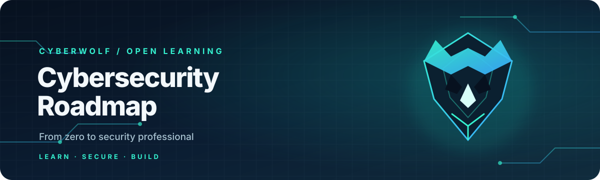
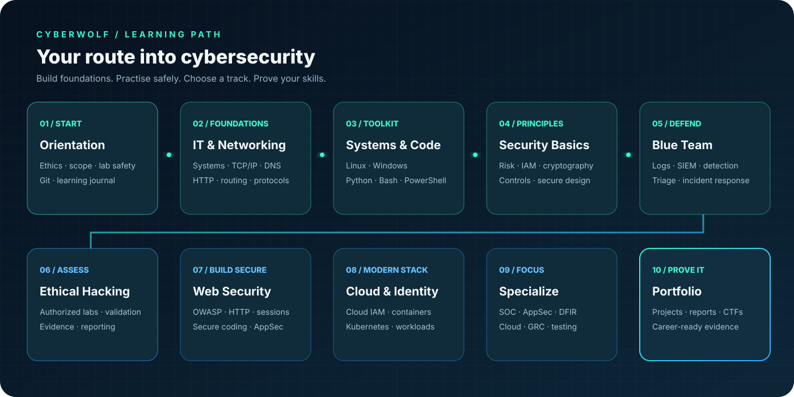
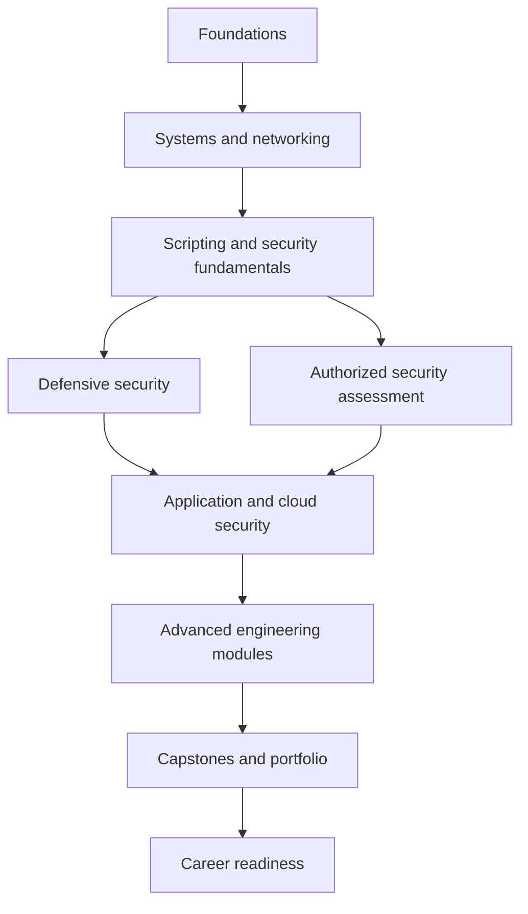

<p align="center">
  
</p>

<p align="center">
  <strong>Learn. Secure. Build.</strong><br>
  Open-source cybersecurity education from first principles to advanced security engineering.
</p>

<p align="center">
  <a href="https://github.com/Rahulprasad29V/cybersecurity-roadmap/stargazers"></a>
  <a href="https://github.com/Rahulprasad29V/cybersecurity-roadmap/network/members"></a>
  <a href="https://img.shields.io/github/license/Rahulprasad29V/cybersecurity-roadmap"></a>
  <a href="https://github.com/Rahulprasad29V/cybersecurity-roadmap/actions/workflows/quality.yml"></a>
  <a href="https://github.com/Rahulprasad29V/cybersecurity-roadmap/commits/main"></a>
</p>

---

## The mission

Cybersecurity is a discipline, not a collection of tools. CyberWolf helps learners understand systems, design safer architectures, investigate evidence, assess risk and demonstrate skills through reproducible practical work.

**Built for:** beginners · students · ethical security practitioners · SOC analysts · software developers · security engineers · cloud teams · GRC professionals · instructors.

## Explore the learning journey

<p align="center">
  
</p>



## Choose your starting point

| Module | What you get |
|---|---|
| [**Main roadmap**](ROADMAP.md) | Beginner-to-advanced stages and exit criteria |
| [**100-day challenge**](100-days/README.md) | Daily learning activities and progress tracker |
| [**Topic library**](topics/README.md) | 15 foundational and intermediate subject guides |
| [**Role-based paths**](learning-paths/README.md) | Eight professional learning pathways |
| [**Advanced curriculum**](advanced/README.md) | Security architecture, detection, DevSecOps, cloud-native security, identity, threat hunting and incident command |
| [**Advanced 30-day challenge**](advanced/30-day-challenge.md) | Applied engineering sprint with weekly milestones |
| [**Capstones**](capstones/README.md) | Five integrated, multi-domain projects |
| [**Labs**](labs/catalog.md) | Guided exercises with scope, evidence and cleanup |
| [**CTF-style challenges**](ctf-challenges/README.md) | Self-contained offline puzzles and explanations |
| [**Quiz bank**](quizzes/README.md) | Beginner through advanced scenario-based JSON question banks |
| [**Assessment framework**](assessments/README.md) | Rubrics for labs, reports, architecture and capstones |
| [**Synthetic datasets**](datasets/README.md) | Fictional logs, asset records, cloud findings and risk backlogs |
| [**Career pathways**](career-paths/README.md) | Role-to-skill map and portfolio guidance |
| [**Cheat sheets**](cheat-sheets/README.md) | Networking, Linux, Python and web security references |
| [**Glossary**](glossary/README.md) | Cybersecurity terminology in CSV format |
| [**Curriculum catalog**](curriculum/README.md) | Versioned machine-readable module manifest |
| [**Instructor guide**](instructor-guide/README.md) | Cohort plans, lesson plans and assessment delivery |
| [**Student progress templates**](student-progress/README.md) | Local learner-owned progress records |
| [**Templates**](templates/learning-journal.md) | Threat models, detection specs, ADRs and report templates |

## Advanced engineering

The advanced tier is designed for learners who already understand networking, operating systems, scripting and security fundamentals.

- **Architecture:** trust boundaries, threat modeling, abuse cases and residual-risk decisions.
- **Detection engineering:** hypotheses, telemetry quality, analytic testing, tuning and triage.
- **DevSecOps:** secure delivery pipelines, dependency risk, secrets, provenance and release assurance.
- **Cloud-native security:** workload identity, Kubernetes boundaries, containers and posture reviews.
- **Enterprise identity:** federation, privilege lifecycle, service identities and access certification.
- **Threat hunting:** hypothesis-driven analysis, coverage gaps and defensible conclusions.
- **Vulnerability management:** asset-aware prioritization, exceptions and retesting.
- **Incident command:** decision logs, communications, containment trade-offs and recovery.

Use the [synthetic training datasets](datasets/README.md) and [capstone acceptance criteria](capstones/README.md) to produce evidence that can be reviewed.

## Practical proof, not tool collecting

Every substantial exercise should produce:
1. A clear objective, authorized scope and assumptions.
2. A repeatable method and evidence log.
3. Findings supported by evidence—not unsupported claims.
4. Risk reasoning, remediation and validation.
5. Limitations, privacy checks and cleanup records.

## Repository architecture

```text
cybersecurity-roadmap/
├── architecture/       # Learning system design, standards and safety
├── advanced/           # Advanced security engineering curriculum
├── learning-paths/     # Role-based learning sequences
├── curriculum/         # Versioned JSON manifest and schema
├── topics/             # Core study guides
├── 100-days/           # 100 daily challenge files
├── quizzes/            # JSON question banks and schema
├── labs/               # Lab catalog, exercises and templates
├── ctf-challenges/     # Safe offline puzzles
├── capstones/          # Integrated final projects
├── assessments/        # Rubrics and assessment framework
├── datasets/           # Synthetic datasets and manifest
├── career-paths/       # Career skill maps
├── cheat-sheets/       # Technical quick references
├── glossary/           # Searchable terminology
├── student-progress/   # Private local progress templates
├── achievements/       # Manual learning milestones
├── weekly-planner/     # Study plans and retrospectives
├── instructor-guide/   # Cohort and lesson delivery
├── projects/           # Portfolio project briefs
├── resources/          # Official docs, courses and references
├── templates/          # Reusable engineering and reporting templates
├── scripts/            # Repository validation tools
└── .github/workflows/  # Automated quality gates
```

## Content quality and maintenance

GitHub Actions validates local Markdown links, the 100-day sequence, structured quiz data, achievements, curriculum modules and synthetic dataset manifests. See [curriculum release process](curriculum/RELEASE_PROCESS.md) for review and versioning guidance.

## Safety and legal boundaries

> [!IMPORTANT]
> **Authorization is mandatory.** Only assess systems you own or have explicit written permission to test. Stay within the exact scope, rules and time window.

Use local virtual machines, synthetic data, CTFs and intentionally vulnerable training applications. This repository does not authorize testing third-party systems. Do not contribute credential theft, malware deployment, evasion, persistence, destructive actions, denial-of-service or data-exfiltration instructions.

Never publish credentials, tokens, private keys, real incident records, personal data or confidential architecture.

## Repository-only capability boundary

This is a content-first open-source repository. It provides learning material and reusable data formats. It does not provide student accounts, a central database, live synchronized progress, automatic online grading, CTF scoring, proctored assessments or verified certificate issuance. Learners keep personal progress in private local copies. A separate application and backend would be required for those live services.

## Contribute

- Read [CONTRIBUTING.md](CONTRIBUTING.md).
- Follow the [Code of Conduct](CODE_OF_CONDUCT.md).
- Review the [Security Policy](SECURITY.md).
- Use the [content standards](architecture/content-standards.md) and [release process](curriculum/RELEASE_PROCESS.md).

---

<p align="center">
  <strong>CYBERWOLF</strong><br>
  <sub>Learn. Secure. Build. · Open-source cybersecurity education</sub>
</p>
