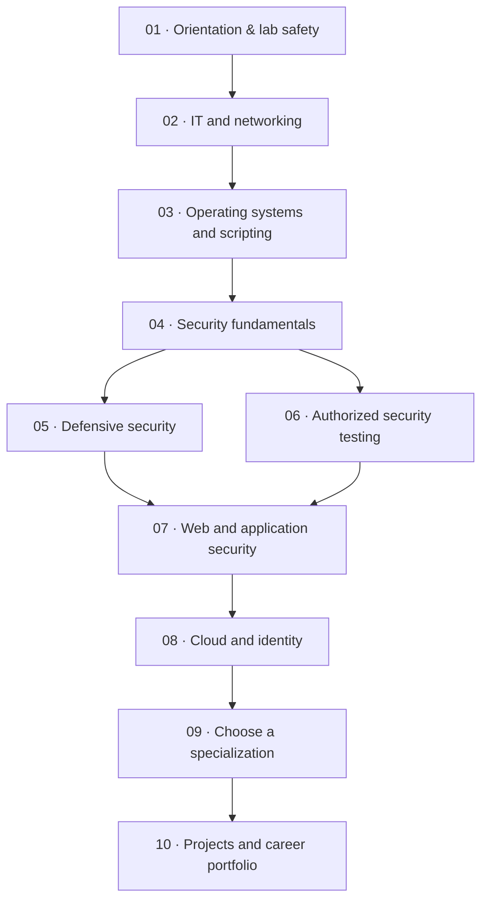

<p align="center">
  
</p>

<p align="center">
  <strong>Learn. Secure. Build.</strong><br>
  A practical, open learning path from IT fundamentals to advanced cybersecurity specializations.
</p>

<p align="center">
  <a href="https://github.com/Rahulprasad29V/cybersecurity-roadmap/stargazers"></a>
  <a href="https://github.com/Rahulprasad29V/cybersecurity-roadmap/network/members"></a>
  <a href="https://github.com/Rahulprasad29V/cybersecurity-roadmap/blob/main/LICENSE"></a>
  <a href="https://github.com/Rahulprasad29V/cybersecurity-roadmap/actions/workflows/quality.yml"></a>
  <a href="https://github.com/Rahulprasad29V/cybersecurity-roadmap/commits/main"></a>
</p>

---

## The mission

Cybersecurity is a discipline, not a collection of tools. This roadmap helps learners understand how systems work, how to protect them, how to assess them responsibly, and how to prove their skills through practical work.

**Designed for:** complete beginners · students · aspiring ethical hackers · SOC analysts · developers · security engineers · career switchers.

## Explore the roadmap

<p align="center">
  
</p>

### The learning flow



## The complete learning ecosystem

The repository now includes more than a reading roadmap. Use the modules below to study, practise, self-assess and build a portfolio.

| Module | What it adds |
|---|---|
| [Architecture](architecture/README.md) | Content model, learner flow, standards and safety boundaries |
| [Role-based learning paths](learning-paths/README.md) | Eight focused tracks from SOC to GRC and threat intelligence |
| [Quiz bank](quizzes/README.md) | Versioned JSON quizzes with explanations and a schema |
| [Practical lab catalog](labs/catalog.md) | Reusable lab briefs, evidence requirements and safe scope |
| [Offline CTF challenges](ctf-challenges/README.md) | Self-contained puzzles with hints and explanations |
| [Career pathways](career-paths/README.md) | Role-to-skill map and portfolio guidance |
| [Cheat sheets](cheat-sheets/README.md) | Networking, Linux, Python and web-security quick references |
| [Glossary](glossary/README.md) | Searchable cybersecurity terminology |
| [Weekly planner](weekly-planner/README.md) | Study plan and weekly retrospective |
| [Achievements](achievements/README.md) | Criteria-based learning milestones |
| [Student progress templates](student-progress/README.md) | Learner-owned local progress files |
| [Community guidelines](community/README.md) | Safe collaboration and question-writing guidance |

**Repository-only limitation:** these files provide the curriculum and reusable data. They do not create student logins, shared live progress, automatic quiz grading, online CTF scoring or verified certificates. Personal progress templates should remain in a learner's private local copy.

## Start here

| Path | What you'll get |
|---|---|
| [**Complete roadmap**](ROADMAP.md) | Competency-based stages, practice goals and exit criteria |
| [**100-day challenge**](100-days/README.md) | One guided activity per day, with [progress tracker](100-days/progress-tracker.md) |
| [**Topic library**](topics/README.md) | 15 focused guides from fundamentals to specialist domains |
| [**Project studio**](projects/README.md) | Portfolio projects grouped by difficulty |
| [**Lab setup**](labs/README.md) | Safe home-lab guidance and reputable practice platforms |
| [**Toolbox**](tools/README.md) | What common security tools do—and their limitations |
| [**Resource library**](resources/README.md) | Official docs, standards, learning platforms and certifications |
| [**Templates**](templates/learning-journal.md) | Learning journal, lab report and vulnerability report |

## Choose a direction

| Track | Focus areas | Build evidence with |
|---|---|---|
| **SOC / Blue Team** | Logs, SIEM, endpoint telemetry, detection and response | Alert triage, detection logic, incident report |
| **Penetration Testing** | Scope, discovery, validation and reporting | Authorized lab assessment |
| **Application Security** | Secure coding, threat modeling, OWASP and testing | Fixed demo application and regression tests |
| **Cloud Security** | IAM, cloud posture, workloads and data protection | Cloud security review |
| **DFIR** | Evidence handling, timelines and investigations | Forensic case notes |
| **Malware Analysis** | Safe static analysis and behavioral detection | Benign sample analysis report |
| **GRC** | Risk, policies, controls, audit and privacy | Risk register and control mapping |
| **Security Engineering** | Architecture, automation, hardening and monitoring | Secure reference architecture |

You do not need to choose a specialization on Day 1. Build the foundations first, then follow the track that matches your interests.

## The 100-day challenge

A structured sequence of daily activities covering networking, Linux, Windows, programming, security principles, blue-team practice, authorized assessment, web security, cloud, forensics and portfolio development.

- Start with [Day 001](100-days/DAY-001.md).
- Browse the [complete day index](100-days/README.md).
- Track your progress in [progress-tracker.md](100-days/progress-tracker.md).

**Suggested pace:** 45–90 minutes per day. This is a learning guide, not a race. Repeat topics until you can explain and demonstrate them.

## Build, don't just read

The project path moves from small scripts and security checklists to packet investigations, web application reviews, detection engineering, cloud posture reviews and secure architecture.

Every portfolio project should explain:
1. The problem and authorized scope.
2. The environment, assumptions and methodology.
3. Evidence and test results.
4. Findings, defensive lessons or remediation.
5. Limitations and what remains untested.

## Repository structure

```text
cybersecurity-roadmap/
├── assets/                 # CyberWolf banner and roadmap visuals
├── topics/                 # 15 cybersecurity study guides
├── 100-days/               # Daily challenge, 100 day files and tracker
├── projects/               # Beginner, intermediate and advanced projects
├── labs/                   # Home-lab setup and practice platforms
├── tools/                  # Security tool guide
├── resources/              # Courses, documentation, books and certifications
├── architecture/           # Content model, workflows and safety principles
├── learning-paths/         # Role-based learning sequences
├── quizzes/                # Versioned JSON question banks
├── ctf-challenges/         # Safe offline puzzles
├── career-paths/           # Role maps and readiness guides
├── cheat-sheets/           # Quick technical references
├── glossary/               # Cybersecurity terminology
├── weekly-planner/         # Study planning templates
├── achievements/           # Manual learning milestones
├── student-progress/       # Private learner-owned templates
├── community/              # Community learning guidelines
├── templates/              # Learning journal and report templates
├── scripts/                # Repository quality checks
├── .github/                # Workflows and contribution templates
├── README.md
├── ROADMAP.md
├── CONTRIBUTING.md
├── SECURITY.md
├── CODE_OF_CONDUCT.md
└── LICENSE
```

## Learn responsibly

> [!IMPORTANT]
> **Authorization is mandatory.** Only test systems you own or have explicit written permission to assess. Stay within the defined scope and follow the platform's rules.

Use local virtual machines, synthetic data, CTFs and intentionally vulnerable training applications. Never scan, exploit, disrupt or access third-party systems without authorization. Do not publish credentials, tokens, private keys, personal data or sensitive evidence.

## Contribute to CyberWolf

Corrections, safe lab exercises, clearer explanations and maintained learning resources are welcome.

- Read [Contributing Guidelines](CONTRIBUTING.md).
- Follow the [Code of Conduct](CODE_OF_CONDUCT.md).
- Review the [Security Policy](SECURITY.md).
- Open an issue for content improvements or submit a pull request.

---

<p align="center">
  <strong>CYBERWOLF</strong><br>
  <sub>Learn. Secure. Build. · Open-source cybersecurity education</sub>
</p>
