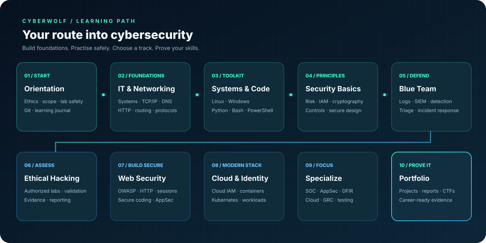
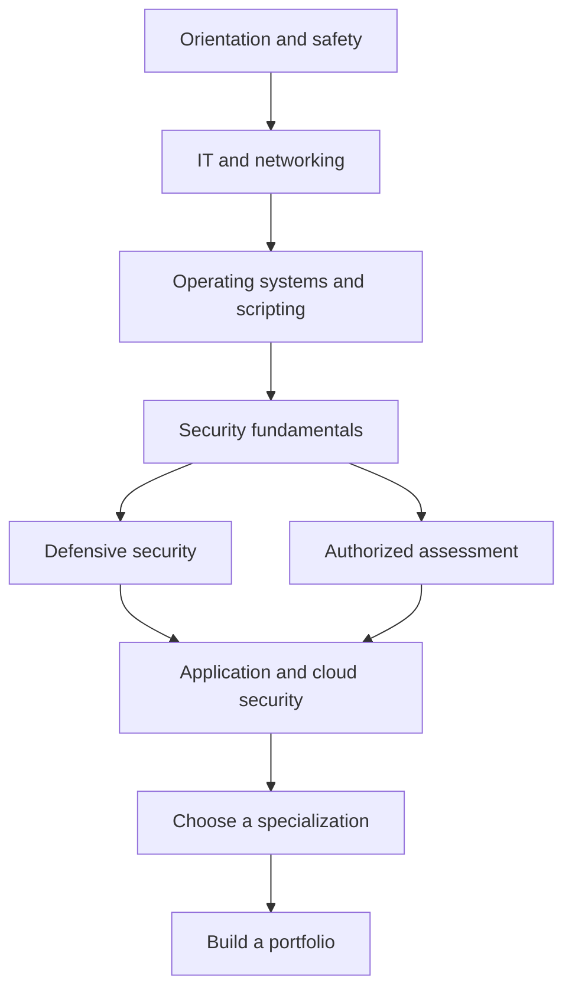

# CyberWolf Cybersecurity Roadmap

  

> **A competency-based path from beginner to advanced.** Progress when you can explain and demonstrate the outcomes—not simply when a calendar period ends.

**Quick links:** [100-day challenge](100-days/README.md) · [Topic library](topics/README.md) · [Projects](projects/README.md) · [Labs](labs/README.md) · [Learning resources](resources/README.md)

## How the stages connect

---

## Stage 0 — Orientation and safe practice
**Learn:** What cybersecurity protects; confidentiality, integrity, availability, privacy and safety; authorization, scope, rules of engagement, responsible disclosure; Git and note-taking.

**Do:** Set up a dedicated learning journal and lab directory. Read every practice platform's policies. Use snapshots and backups before experiments.

**Exit criteria:** Explain why written authorization and defined scope are mandatory. Keep secrets out of public repositories.

## Stage 1 — Computer and networking fundamentals
**Learn:** CPU, memory, storage, processes, filesystems, virtualization; binary and hexadecimal; OSI and TCP/IP models; Ethernet, ARP, IP, TCP, UDP, ICMP; subnetting, routing, NAT, firewalls; DNS, DHCP, HTTP/S, SSH and NTP.

**Do:** Draw a home-lab network diagram. Inspect your own machine's IP configuration and routes. Capture and explain a DNS lookup generated by your own device in Wireshark.

**Exit criteria:** Explain a browser-to-server request and interpret basic packet metadata.

## Stage 2 — Operating systems and scripting
**Learn:** Linux shell, permissions, users/groups, services, processes, package managers and logs; Windows accounts, services, Event Viewer and PowerShell; Python fundamentals, files, JSON, regular expressions and exceptions; Bash, PowerShell, Git and version control.

**Do:** Parse synthetic log data. Create a least-privilege user in a disposable VM. Inspect system and authentication logs.

**Exit criteria:** Navigate Linux and Windows and write a small, documented automation script.

## Stage 3 — Security fundamentals and cryptography
**Learn:** CIA triad, least privilege, defense in depth, secure defaults, threats, vulnerabilities, exploits and risk; authentication, authorization, MFA and password managers; hashing versus encryption versus encoding; symmetric/asymmetric cryptography, certificates, TLS and key management.

**Do:** Threat-model a simple application. Hash harmless sample files. Create a personal security baseline.

**Exit criteria:** Explain core security principles and select suitable controls for a scenario.

## Stage 4 — Defensive security
**Learn:** Asset and vulnerability management, patching, logs and telemetry, SIEM concepts, alert triage, endpoint security, IDS/IPS, threat intelligence, incident response, backup and recovery.

**Do:** Analyze synthetic authentication logs. Write a triage note for a simulated suspicious login. Design a detection idea and discuss false positives.

**Exit criteria:** Produce an incident triage report that separates facts, assumptions and next steps.

## Stage 5 — Ethical hacking methodology
**Learn:** Written authorization, scope, exclusions, rules of engagement and stop conditions; reconnaissance and asset discovery in labs; scanning concepts, vulnerability validation, evidence handling, remediation, retesting and reporting.

**Do:** Use a local VM or explicitly authorized platform target. Verify a low-impact lab finding. Create a reproducible report with remediation steps.

**Exit criteria:** Complete a scoped assessment report for a lab target.

## Stage 6 — Web and application security
**Learn:** HTTP, headers, cookies, sessions, same-origin policy and CORS; authentication and access control; injection, XSS, CSRF, SSRF, path traversal and file upload risks; secure coding, dependency management, secrets handling, OWASP Top 10 and ASVS; SAST and DAST.

**Do:** Complete PortSwigger Web Security Academy labs. Test OWASP Juice Shop locally. Fix a deliberately vulnerable sample application and write regression tests.

**Exit criteria:** Explain root cause, impact, evidence and remediation for common web weaknesses.

## Stage 7 — Cloud, containers and identity
**Learn:** Shared responsibility, cloud IAM, network segmentation, storage permissions, logging, encryption, workload identity, Docker, registries, Kubernetes RBAC, network policies and infrastructure-as-code security.

**Do:** Review a sandbox account or sample architecture. Scan your own container image. Add secret and dependency checks to a demo CI pipeline.

**Exit criteria:** Identify common cloud misconfigurations and propose least-privilege fixes.

## Stage 8 — Choose a specialization
| Track | Focus | Portfolio evidence |
|---|---|---|
| SOC / Blue Team | SIEM, detection, endpoint telemetry, incident response | Alert investigation and detection rule |
| Penetration Testing | Scope, enumeration, safe validation, reporting | Authorized lab assessment |
| Application Security | Secure coding, threat modeling, testing | Fixed vulnerable app and regression tests |
| Cloud Security | IAM, posture, workload and data protection | Cloud review report |
| DFIR | Acquisition, timelines, artifacts, evidence integrity | Forensic case notes |
| Malware Analysis | Safe static/dynamic analysis and detection | Benign sample analysis report |
| GRC | Risk, policies, controls and audit evidence | Risk register and control mapping |
| Security Engineering | Architecture, automation, hardening and detection | Secure reference architecture |

## Stage 9 — Advanced practice and career readiness
Read vendor documentation and primary standards. Reproduce findings only in controlled environments. Build a sanitized portfolio, practise technical writing and interviews, and review legal and ethical obligations in your jurisdiction.

**Completion standard:** Demonstrate repeatable skills through projects, reports and practical explanations. A completed checklist alone is not proof of professional competence.
