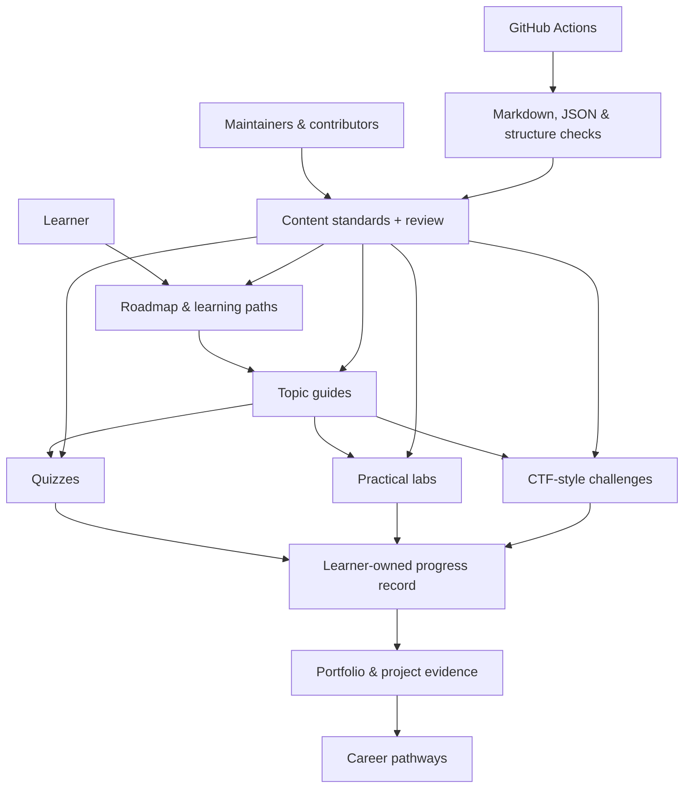

# Learning Ecosystem Architecture

CyberWolf is organized as a **content-first cybersecurity learning system**. GitHub is the source of truth for curriculum, guides, quizzes, lab briefs, challenges, reference material and templates.

## Architecture at a glance

## Repository modules

| Module | Purpose | Primary artifacts |
|---|---|---|
| `ROADMAP.md` and `topics/` | Core curriculum | Stages, study guides, outcomes |
| `learning-paths/` | Role-based learning | SOC, AppSec, cloud, DFIR and more |
| `100-days/` | Guided sequence | Day briefs, index, tracker |
| `quizzes/` | Knowledge checks | Versioned JSON question banks |
| `labs/` | Practical learning | Lab catalog, briefs, evidence templates |
| `ctf-challenges/` | Safe problem solving | Offline puzzles and challenge briefs |
| `projects/` | Portfolio development | Project briefs by difficulty |
| `career-paths/` | Career readiness | Role skills, milestones, portfolio ideas |
| `cheat-sheets/` and `glossary/` | Quick reference | Concise references and definitions |
| `student-progress/` | Personal planning | Local templates; learner-owned records |
| `achievements/` | Motivation | Criteria-based, manually tracked badges |
| `weekly-planner/` | Study rhythm | Weekly plan and retrospective |
| `resources/` | Further study | Official documentation and courses |

## Design principles

1. **Content-first:** learning material remains readable without a special app.
2. **Portable:** Markdown, CSV and JSON can be used with GitHub, local editors or future software.
3. **Evidence-based:** learners record what they did and how they verified it.
4. **Safe by default:** labs use local, synthetic or explicitly authorized environments.
5. **Accessible:** plain language, predictable headings, text alternatives and no color-only meaning.
6. **Maintainable:** consistent templates, versioned data and automated repository checks.

## What this repository does—and does not do

This repository supplies curriculum and reusable files. It does **not** provide user accounts, a database, live synchronized student progress, an online quiz engine, automatic CTF scoring, proctored exams or certificate issuance. Learners keep progress records in their own copy unless a future application is deliberately built.

## Suggested learner flow

1. Read the main [roadmap](../ROADMAP.md) and choose a starting stage.
2. Follow one learning path from [learning paths](../learning-paths/README.md).
3. Study the linked topic guide.
4. Complete the quiz, lab or offline challenge.
5. Save a sanitized report using the templates.
6. Update a local copy of [student progress](../student-progress/README.md).
7. Turn substantial work into a portfolio project.

## Maintainer flow

Contributors submit focused changes. Maintainers review technical accuracy, authorization boundaries, sources, privacy and accessibility. GitHub Actions checks repository structure, internal links and structured learning content before changes are accepted.
